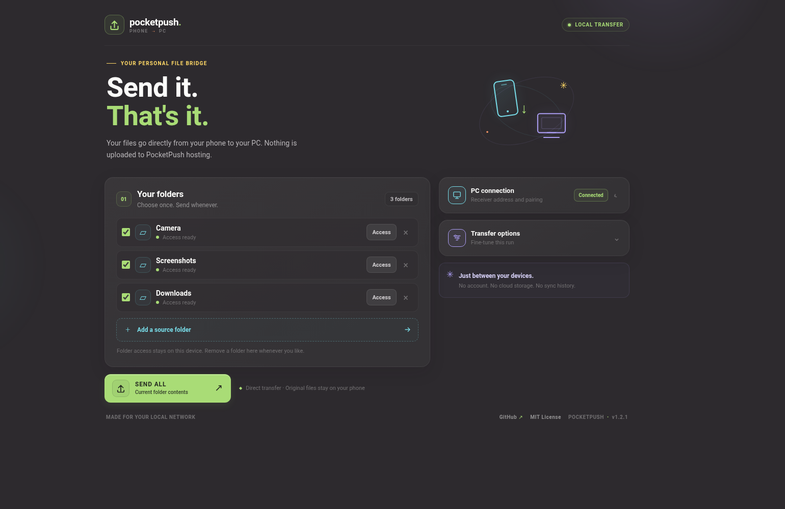
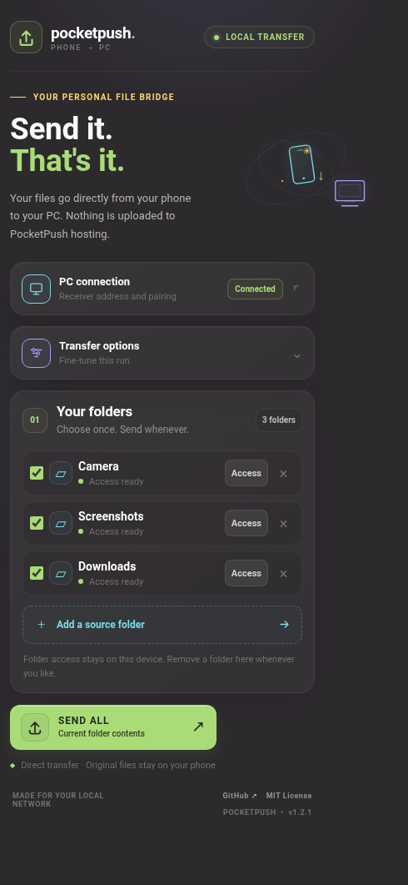

# PocketPush

**Current release: 1.2.7** — modular PWA source, HTTPS-encrypted local transfers, live byte-level progress, and a one-time pairing-key rotation utility.

PocketPush is a deliberately simple Android-to-Windows folder sender. Pick phone folders once, then send their current contents to one Windows folder with one button.

- **Android:** installable Progressive Web App (PWA), designed for current Chrome on Android.
- **Windows:** small PowerShell receiver included in this folder.
- **Transport:** HTTPS directly over your local Wi-Fi/LAN.
- **Hosting:** static PWA files can be hosted free, for example on GitHub Pages. The receiver and file transfers remain local.
- **No accounts, cloud backend, sync engine, transfer database, or automatic phone-side deletion.**

## What it does

1. Remembers selected Android source-folder handles in browser-local IndexedDB.
2. Reads the current contents of enabled folders when you press **SEND ALL**.
3. Uploads each file directly to the Windows receiver through an encrypted HTTPS connection.
4. Saves files flat into the configured Windows destination folder.
5. If a filename already exists, the receiver creates `name (1).ext`, `name (2).ext`, etc. It never silently overwrites an existing file.
6. Optionally lets you preview a batch and untick files to skip for that run.
7. Shows live upload progress in bytes, average transfer speed, and estimated remaining time.
8. If a transfer partially fails, the app offers **Retry failed files** while it remains open. This short-lived retry list is held only in memory and discarded when the app closes or a new batch starts.

It intentionally does **not** remember what has been sent before. Files left on the phone are sent again on the next run. Phone originals are never deleted.

## Requirements

- Android with a current Chrome version supporting the File System Access API and Local Network Access permission.
- A Windows 10/11 PC and phone connected to the same ordinary home Wi-Fi/LAN (not a guest network with client isolation).
- Windows PowerShell 5.1 or newer (included with Windows).
- A trusted local CA certificate installed once on Android. Chrome uses user-added TLS server certificates from the platform trust store by default; some Android skins use different settings labels.

## Updating an existing installation

This release changes the Windows receiver from HTTP to HTTPS. It is **not a web-only update**.

1. Stop the old receiver with `Ctrl+C`.
2. Back up `windows/settings.json` somewhere safe. It contains your destination path and pairing key.
3. Replace the repository's `web` and `windows` folders with those from this release. Do **not** delete or replace your existing `windows/settings.json`.
4. Run `windows/Install-PocketPush.cmd` as administrator. It creates/reuses the local CA, issues a server certificate for the PC's current IP addresses, configures the HTTPS binding, and refreshes the firewall rule. It preserves `settings.json`.
5. Copy `windows/PocketPush-Local-CA.cer` to your Android phone, preferably over USB or LocalSend (it is a public certificate; it contains no private key).
6. On Android, install it as a **CA certificate**. A typical path is **Settings → Security & privacy → More security settings → Encryption & credentials → Install a certificate → CA certificate**. Labels vary by manufacturer. Android will show a security warning because this adds a user-managed trust anchor; this is expected. Only install the certificate you generated on your own PC.
7. Restart Chrome on Android.
8. Run `windows/Rotate-Pairing-Key.cmd` once. This invalidates the pairing key previously shared in chat and prints a fresh key. Keep the new key private.
9. Start `windows/Start-PocketPush.cmd`. It prints the current PC IP addresses and the new pairing key.
10. Open PocketPush on Android. Enter the PC IP address and new key, then tap **Test & save connection**. The app automatically uses `https://` and port `8765`.

The local CA's private key remains in the Windows machine certificate store and is never exported. The `.cer` file contains only its public certificate. The CA is marked as a CA that can issue end-entity certificates only (`pathLen=0`) and carries the TLS Server Authentication EKU. It is still a user-trusted CA, so protect the Windows PC and remove the CA from Android when you stop using PocketPush. You only need to install that CA once. If your PC's LAN IP changes, rerun `Install-PocketPush.cmd` to issue a new server certificate with the new address; you do not need to reinstall the CA certificate on Android.

## Part A — publish the PWA (free static hosting)

The PWA needs an HTTPS origin to access Android folders and connect to the local receiver. GitHub Pages provides free static hosting for public repositories. It hosts only the app files; the phone's files never go to GitHub.

1. Use your repository: [Vraxo/PocketPush](https://github.com/Vraxo/PocketPush).
2. Put the contents of this project folder in the repository root. Keep `web/` and `.github/workflows/pages.yml` in place.
3. In repository **Settings → Pages**, set the build/deployment source to **GitHub Actions**.
4. Push to `main` (or run the workflow from **Actions → Deploy PocketPush PWA**).
5. Open `https://vraxo.github.io/PocketPush/` in Chrome on Android.
6. Choose **Add to Home screen** or **Install app** from Chrome's menu.

The service worker caches the app shell for offline launches. Internet is needed for the initial visit/install and later updates, not for file transfers. The receiver and transferred files never use GitHub Pages.

## Part B — prepare Windows

1. Copy the `windows` folder to a permanent location, e.g. `C:\Tools\PocketPush`.
2. Double-click `Install-PocketPush.cmd` and approve the administrator prompt. It:
   - creates a local certificate authority if one does not already exist;
   - issues a TLS server certificate containing the PC's current IPv4 addresses;
   - configures HTTP.sys to serve HTTPS on port `8765`;
   - creates a Windows Firewall inbound rule for TCP `8765`, limited to the **Private** profile and local subnet;
   - reserves the HTTPS URL for the current Windows account;
   - exports the public CA certificate as `PocketPush-Local-CA.cer`.
3. If Windows marks your trusted home network as **Public**, change it to **Private** in **Settings → Network & Internet → Wi-Fi/Ethernet → your connected network → Network profile type**.
4. On an existing installation, run `Rotate-Pairing-Key.cmd` once because the previous key was exposed in chat. This preserves your destination path.
5. Start `Start-PocketPush.cmd` normally (not as administrator).
6. On first launch, enter the destination directory. You can use your existing LocalSend folder, or press Enter to use `Incoming` beside the scripts.
7. The receiver prints current PC IP addresses and the pairing key. Keep the receiver window open while sending.

The first run creates `windows/settings.json` with the destination and pairing key. Keep it private. The installer does not overwrite it. The pairing key is a local shared secret; anyone who has it and can reach the receiver can upload files into the destination directory. Run `Rotate-Pairing-Key.cmd` while the receiver is stopped to invalidate an exposed key without changing the destination.

## Part C — pair Android and choose folders

1. Copy `PocketPush-Local-CA.cer` from Windows to Android (USB transfer recommended).
2. Install it on Android as a **CA certificate** through the system's credential/certificate settings.
3. Restart Chrome.
4. Open the installed PocketPush PWA.
5. Enter the PC IP address printed by Windows (for example, `192.168.1.104`) and the current pairing key.
6. Tap **Test & save connection**. Chrome may ask whether PocketPush can access devices on your local network; allow it.
7. Tap **Add a source folder** and choose a phone folder, e.g. `DCIM/Camera`. Repeat for other folders.
8. Leave desired folders enabled and tap **SEND ALL**.

The address field accepts a bare IP. PocketPush automatically uses `https://` and port `8765`; full `https://` addresses are also accepted.

The first time you use a saved folder handle after a browser restart, Chrome may ask to renew its read permission. The **Access** button beside each folder can renew it.

## Everyday use

1. Start `Start-PocketPush.cmd` on Windows.
2. Open PocketPush on Android.
3. Tap **SEND ALL**.
4. Keep PocketPush in the foreground and the Windows receiver window open until the transfer finishes.

The **Review before sending** option is off by default. Turn it on for an exceptional run to preview files and untick anything to skip just that time. Those exclusions are not saved. **Include subfolders** is on by default.

## Security and privacy

- Phone-to-PC transfers use HTTPS. The receiver certificate is signed by a private local CA generated on your PC. The CA's private key remains in the Windows machine certificate store; only its public `.cer` file is exported.
- Android must trust the CA once. Installing a user CA is a meaningful security decision: Chrome can trust certificates issued by that CA. Only install the CA certificate you generated yourself and keep the Windows PC protected. When uninstalling, remove PocketPush Local CA from Android under **Trusted credentials → User**, then run `Uninstall-PocketPush-HTTPS.cmd` on Windows as administrator.
- The pairing key is required for every health check and upload. It is stored in `windows/settings.json` and the PWA's local browser storage. Rotate it with `Rotate-Pairing-Key.cmd` if it is exposed.
- The receiver does not expose a file listing, download endpoint, or remote file browser.
- The Windows Firewall rule only permits connections from the local subnet while the active network profile is Private. Do not forward port `8765` from your router or expose it to the internet.
- The GitHub Pages host serves static application files only. Uploads go directly from the phone to the PC's private IP address.

## Roll back to the previous HTTP release

If the local CA installation or HTTPS receiver is incompatible with your Android build, you can return to the previous v1.1.2 HTTP setup:

1. Stop PocketPush with `Ctrl+C`.
2. Run `Uninstall-PocketPush-HTTPS.cmd` from the v1.2.0 `windows` folder as administrator. This removes the PocketPush TLS binding, CA certificates and firewall rule but leaves `settings.json` and your destination folder intact.
3. Remove **PocketPush Local CA** from Android under **User credentials / Trusted credentials → User**.
4. Restore the v1.1.2 `web` and `windows` folders from your backup or previous release archive. Keep the existing `windows/settings.json`.
5. Run the v1.1.2 `Install-Windows-Setup.cmd` as administrator to restore its HTTP URL reservation and firewall rule, then start its receiver.

The v1.2.0 PWA always upgrades receiver addresses to HTTPS, so restore the matching v1.1.2 web files as part of the rollback.

## Troubleshooting

**The browser says the connection is not private / certificate is invalid**

- Confirm `PocketPush-Local-CA.cer` was installed on Android as a **CA certificate**, not as a Wi-Fi or VPN certificate.
- Restart Chrome after installing the CA.
- If the PC's IP address changed, rerun `Install-PocketPush.cmd` and use the newly printed address.
- Do not bypass the browser's certificate warning. Recheck the certificate installation instead.

**The app cannot reach the receiver**

- Confirm the Windows console says `Receiver is running` and shows the current HTTPS address.
- Make sure both devices are on the same non-guest Wi-Fi/LAN.
- Confirm the Windows network profile is Private.
- In Chrome, allow **Local network** access for the PocketPush site.
- Run `Install-PocketPush.cmd` as administrator if the HTTPS binding, URL reservation or firewall rule was not configured.

**Pairing key rejected**

Run `Rotate-Pairing-Key.cmd` to generate a fresh key, restart the receiver, and enter the newly printed key in the PWA.

**Folder access needs renewal**

Tap **Access** beside the source folder. If that fails, remove and add the folder again.

**A file arrived with `(1)` in its name**

A file with that name already existed in the destination. PocketPush avoids overwriting it. It does not attempt to determine whether the existing file is identical.

**The folder picker is unavailable**

Open PocketPush in current Chrome for Android from its HTTPS website or installed PWA. Opening `index.html` directly as a `file://` URL is not supported.

## Project layout

- `web/index.html` — the single semantic document and application shell. It stays as one file because this is one static screen, not a set of independently reusable pages. Fetching HTML fragments at runtime would add startup and offline complexity without much benefit.
- `web/css/` — styles split by responsibility, including `fonts.css` for the self-hosted typeface.
- `web/fonts/` — self-hosted Space Grotesk WOFF2 subsets and their OFL license.
- `web/js/app.js` — the application entry point and event wiring.
- `web/js/core/` — app/storage configuration, current-session state, and shared DOM helpers.
- `web/js/data/` — IndexedDB persistence for Android directory handles.
- `web/js/features/` — separate folder, connection, review, and transfer modules.
- `web/` also contains the icons, service worker and PWA manifest.
- `windows/Start-PhonePush.ps1` — HTTPS receiver (legacy filename retained for existing installs).
- `windows/Install-Windows-Setup.ps1` — CA, TLS binding, URL reservation and firewall setup.
- `windows/Rotate-Pairing-Key.ps1` — pairing-key rotation while preserving the destination folder.
- `windows/Uninstall-PocketPush-HTTPS.ps1` — removes the local TLS setup without deleting the destination or `settings.json`.
- `windows/Start-PocketPush.cmd` / `windows/Install-PocketPush.cmd` — branded launchers.
- `.github/workflows/pages.yml` — free GitHub Pages deployment workflow.
- `docs/screenshots/` — desktop and mobile UI screenshots.

## Limitations

- Files are uploaded one at a time to keep memory use low and make failure reporting simple.
- Folders are flattened into the single destination directory. Duplicate names are automatically renamed.
- No transfer history or deduplication exists by design.
- Large transfers require the PWA to remain in the foreground and the phone to stay awake. Android may pause background tabs.
- A local CA must be installed on each Android device that will use the HTTPS receiver. The Windows server certificate is reissued when setup is run again, for example after the PC's LAN IP changes.

## Interface

The interface uses a flat visual treatment: solid surfaces, restrained borders, compact corner radii, and no gradients or elevation shadows.

## Typography

The PWA self-hosts the Space Grotesk variable font as three WOFF2 subsets (Latin, Latin Extended, and Vietnamese; about 47 KB combined). The files are distributed under the SIL Open Font License 1.1; see [`web/fonts/OFL.txt`](web/fonts/OFL.txt). The font binaries are sourced from Fontsource's Google Fonts distribution at commit `5a72889057f592bb0659629e38337359f94d53b2`.

## License

The application code is MIT-licensed. The Space Grotesk font files in `web/fonts/` are separately licensed under SIL Open Font License 1.1; see [`web/fonts/OFL.txt`](web/fonts/OFL.txt).
